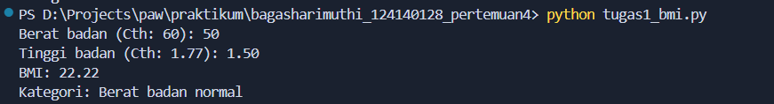
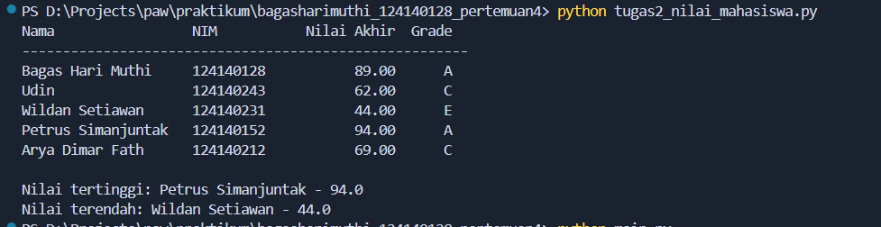
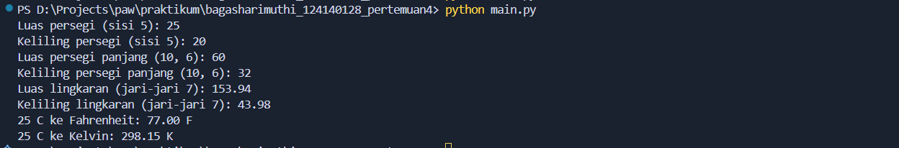

# Praktikum Pemrograman Web - Pertemuan 4

## Identitas Mahasiswa

- **Nama:** Bagas Hari Muthi
- **NIM:** 124140128

## Deskripsi Program

### Soal 1 - Program Penghitung BMI

File: `tugas1_bmi.py`

Program menerima berat badan dalam kilogram dan tinggi badan dalam meter, lalu menghitung BMI dengan rumus `berat / (tinggi * tinggi)`. Program menentukan kategori berat badan berdasarkan nilai BMI dan menampilkan BMI dengan dua angka desimal beserta kategorinya.

### Soal 2 - Pengelolaan Data Nilai Mahasiswa

File: `tugas2_nilai_mahasiswa.py`

Program menyimpan data lima mahasiswa dalam list yang berisi dictionary. Nilai akhir dihitung dengan bobot UTS 30%, UAS 40%, dan tugas 30%. Program menentukan grade, menampilkan data dalam tabel, serta menampilkan mahasiswa dengan nilai akhir tertinggi dan terendah.

### Soal 3 - Modul Matematika dan Program Penggunaannya

- `math_operations.py`: modul berisi fungsi untuk menghitung luas dan keliling persegi, persegi panjang, dan lingkaran, serta konversi Celsius ke Fahrenheit dan Kelvin. Modul menggunakan konstanta `PI`.
- `main.py`: menggunakan dua cara impor, yaitu `import math_operations as math` dan `from math_operations import ...`. Skrip memanggil seluruh fungsi menggunakan contoh nilai dan menampilkan hasilnya.

Setiap fungsi di `math_operations.py` dilengkapi docstring yang menjelaskan parameter dan nilai kembaliannya.

## Cara Menjalankan

Buka terminal pada folder `bagasharimuthi_124140128_pertemuan4`, lalu jalankan program yang diinginkan:

```bash
python tugas1_bmi.py
python tugas2_nilai_mahasiswa.py
python main.py
```

Program BMI akan meminta input berat dan tinggi badan. Dua program lainnya langsung menampilkan hasil di terminal. Pastikan Python 3 sudah terpasang dan perintah `python` tersedia di terminal.

## Screenshot Hasil Eksekusi

| Soal | Tugas | Screenshot |
| :--- | :--- | :--- |
| 1 | BMI |  |
| 2 | Nilai Mahasiswa |  |
| 3 | Modul Matematika |  |