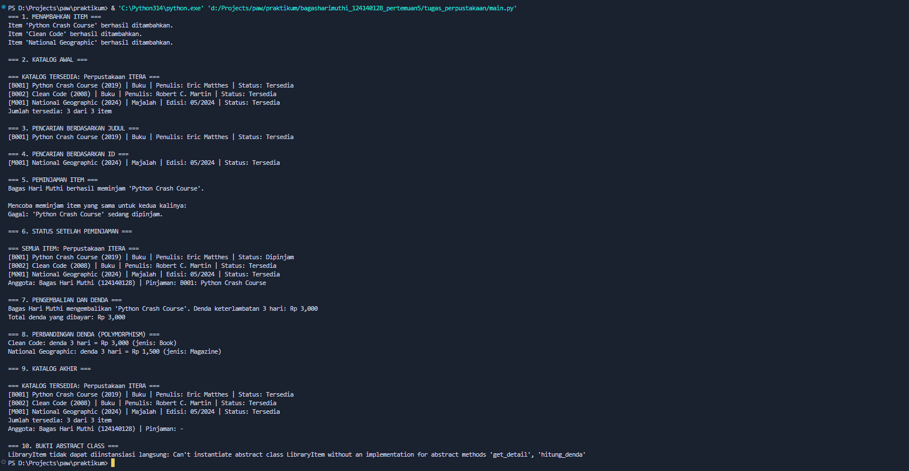

# Pertemuan 5 — Python OOP

## Identitas Mahasiswa

- **Nama Lengkap:** Bagas Hari Muthi
- **NIM:** 124140128
- **Kelas Praktikum:** RB

## Deskripsi Program

Simulasi **Sistem Manajemen Perpustakaan** berbasis OOP Python. Program dapat
menambah item, menampilkan katalog tersedia, mencari item berdasarkan judul
atau ID, meminjam, mengembalikan, dan menghitung denda.

### Alur Program

`main.py` membuat objek `Library`, lalu menambahkan tiga item (`Book` dan
`Magazine`). Setelah itu program menampilkan katalog, mencari item berdasarkan
judul dan ID, meminjam satu item melalui `Member`, dan menampilkan status
koleksi. Program kemudian mengembalikan item sambil menghitung denda,
membandingkan denda antar-subclass, menampilkan katalog akhir, dan membuktikan
bahwa `LibraryItem` tidak dapat diinstansiasi langsung.

## Penerapan Pilar OOP

| Pilar | Implementasi | Lokasi |
|---|---|---|
| **Class & Object** | `LibraryItem`, `Book`, `Magazine`, `Library`, dan `Member`. | `library_item.py`, `library.py`, `member.py` |
| **Abstraction** | `LibraryItem(ABC)` dengan abstract method `hitung_denda()` dan `get_detail()`. | `library_item.py` |
| **Inheritance** | `Book` dan `Magazine` mewarisi `LibraryItem`. | `library_item.py` |
| **Encapsulation** | `__id_item`, `_dipinjam`, `__koleksi`, dan data private `Member`. | `library_item.py`, `library.py`, `member.py` |
| **Polymorphism** | `get_detail()` dan `hitung_denda()` dioverride; `Library` memanggil method secara seragam. | `library_item.py`, `library.py` |
| **Property** | `@property` pada `id_item`, `is_dipinjam`, `total_item`, `item_tersedia`, `nama`, `nim`, dan `daftar_pinjaman`. | Semua modul |

## Struktur Folder

```text
bagasharimuthi_124140128_pertemuan5/
├── latihan/
│   ├── 01_everything_is_object.py
│   ├── 01_procedural_vs_oop.py
│   ├── 02_class_object.py
│   ├── 03_inheritance.py
│   ├── 04_encapsulation.py
│   ├── 05_polymorphism.py
│   └── 06_abstract_class.py
├── tugas_perpustakaan/
│   ├── library_item.py
│   ├── member.py
│   ├── library.py
│   └── main.py
├── screenshot/
│   └── output.png
├── README.md
└── .gitignore
```

## Panduan Menjalankan Program

Prasyarat: Python 3.10+.

```powershell
cd bagasharimuthi_124140128_pertemuan5/tugas_perpustakaan
python main.py
```

## Screenshot Output

Berikut tangkapan layar terminal saat program dijalankan:



Screenshot memperlihatkan penambahan item, katalog, pencarian, status pinjam,
dan perhitungan denda.
